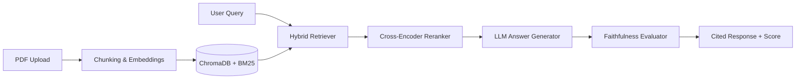

# enterprise-rag-guardrails

# 🛡️ Enterprise RAG with Hybrid Search & Hallucination Guardrails

🔗 **Live Demo:** [Add your Streamlit Cloud or Hugging Face Spaces link here]

## Overview
A production-ready Retrieval-Augmented Generation (RAG) system built for accurate document Q&A with automated faithfulness evaluation. Unlike basic vector-search demos, this pipeline combines semantic and keyword search, reranks results with a cross-encoder, and runs an LLM-as-a-Judge guardrail before returning answers.

## Architecture


## Key Features
* **Hybrid Retrieval:** Combines ChromaDB dense vector search (60%) with BM25 sparse keyword search (40%).
* **Cross-Encoder Reranking:** Uses Hugging Face `ms-marco-MiniLM-L-6-v2` to score and filter top context chunks.
* **Hallucination Guardrail:** Evaluates every generated response using Pydantic structured outputs to verify strict grounding in source documents.
* **Full-Stack & Containerized:** FastAPI REST backend, Streamlit UI, and Docker Compose orchestration.

## Quick Start (Docker)
1. Clone the repository and create your environment file:
   ```bash
   cp .env.example .env
   ```
2. Add your `OPENAI_API_KEY` inside `.env`.
3. Run with Docker Compose:
   ```bash
   docker-compose up --build
   ```
4. Open `http://localhost:8501` for the UI and `http://localhost:8000/docs` for Swagger API docs.
